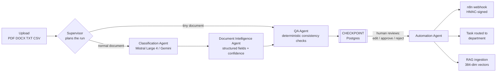
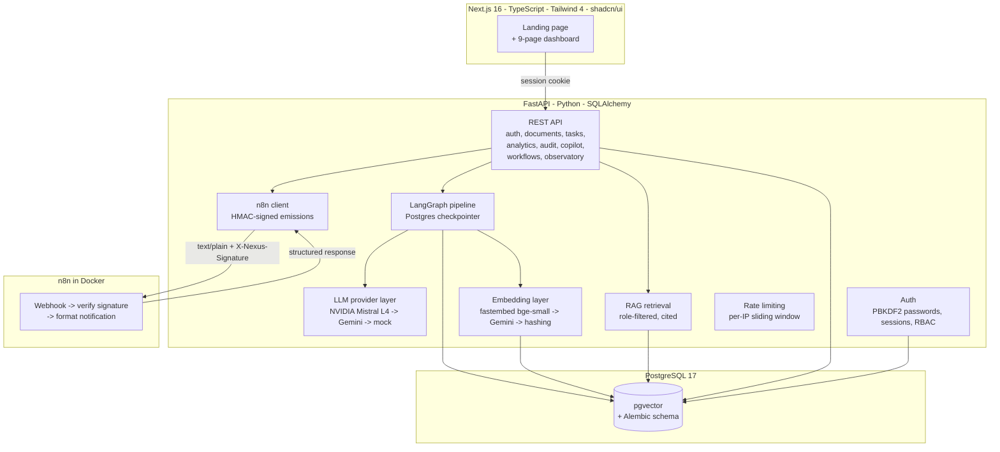
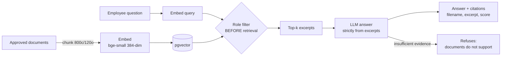
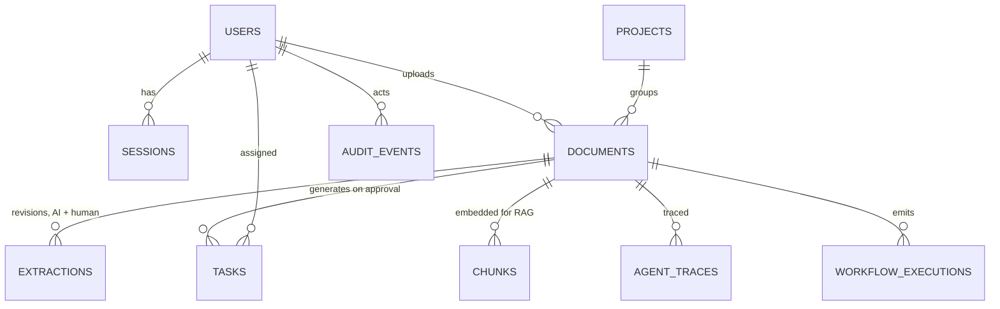

# NEXUS OPS — AI Workflow & Operations Hub

<p align="center">
  <em>Repetitive operations, processed by agents. Approved by humans.</em>
</p>

NEXUS OPS is a production-minded internal platform that turns repetitive business
documents — supplier quotes, purchase requests, intervention and maintenance
reports, meeting minutes — into classified, validated, automatically routed
workflows. A multi-agent pipeline does the reading; a human approves every
consequential action; automation executes what was approved.

**Everything in this repository uses synthetic data.** Nothing represents any real
company, and simulated business numbers are always labeled as simulated.

---

## What actually happens when you upload a document



The pipeline is a **LangGraph state machine**. State is checkpointed to Postgres
after every agent step. The graph **interrupts before the Automation Agent** —
the human approval gate. When a manager approves, the graph *resumes from the
exact saved state*: the Automation Agent creates the routed task and fires a
signed n8n webhook. This is a real interrupt/resume human-in-the-loop pattern,
not a metaphor.

### What each agent does

| Agent | Type | Responsibility |
|---|---|---|
| **Supervisor** | deterministic rules | Plans the run: which agents run, which checks matter, whether the document is too small to extract |
| **Classification Agent** | LLM (Mistral Large 4 / Gemini / mock) | Document type, owning department, priority, confidence |
| **Document Intelligence Agent** | LLM | Extracts supplier, reference, amount, currency, requester, site, due date, summary — validated through Pydantic before storage |
| **QA Agent** | deterministic + confidence gate | Amount ranges, currency codes, ISO dates, past-due detection, missing required fields per type; flags documents below the review threshold |
| **Automation Agent** | n8n + business rules | Creates the routed task, fires the HMAC-signed webhook, closes the human gate |
| **Knowledge Agent** | RAG | Answers questions strictly from approved documents, with citations, role-filtered retrieval |

Every agent invocation is recorded in the **Agent Observatory**: provider, model,
input summary, structured output, latency, tokens in/out, confidence, and status
(`ok` / `fallback` / `error`). The observatory also runs a live **provider
evaluation** — every configured provider classifies the same sample documents so
agreement, confidence and latency can be compared side by side.

---

## System architecture



### LLM provider chain

Providers are interchangeable behind one interface. Selection is automatic by
which API keys exist:

1. **NVIDIA Mistral Large 4** (`mistralai/mistral-large-4-1t-a52b`) — reasoning
   model; configured with `reasoning_effort: low`, 4k token budget, and
   classification + extraction run **in parallel** to hide latency.
2. **Gemini** (`gemini-3.5-flash-lite`) — structured JSON output.
3. **Deterministic mock** — keyword/regex heuristics, zero network: keeps the
   demo alive offline and makes the test suite deterministic.

If a live provider times out, the pipeline **falls back to the mock, flags
degraded confidence, and records the fallback in the observatory** — the product
keeps working and the degradation is visible, never hidden.

### RAG knowledge copilot



Role-based access is applied **before** retrieval: administrators and managers
see everything; employees see only their department's documents. When retrieval
is weak, the copilot says the documents do not support an answer instead of
improvising.


---

## Data model



Key tables: `documents` (status machine: uploaded -> needs_review ->
approved/rejected, original file path retained), `extractions` (append-only
revisions — AI suggestion and human corrections both preserved), `tasks`
(pending_review -> approved -> in_progress -> blocked -> completed),
`chunks` (pgvector 384-dim), `workflow_executions` (every automation emission:
payload, response, error, attempt count), `agent_traces` (observatory),
`audit_events` (append-only, every human and AI action).

Schema is owned by **Alembic**; `alembic upgrade head` runs automatically at
backend startup on Postgres.


---

## Governance, security & honest numbers

- **Passwords**: PBKDF2-HMAC-SHA256, 200k iterations, per-user salt, timing-safe
  comparison. Failed logins are audited.
- **RBAC**: three roles (administrator, manager, employee) enforced **server-side**
  on every consequential endpoint — approve/reject, retries, reminders, evaluation.
- **Rate limiting**: per-IP sliding window on login (8/min) and upload (15/min);
  floods get `429` and a test proves it.
- **Audit trail**: append-only `audit_events` for logins, uploads, views, edits,
  approvals, rejections, workflow outcomes, downloads.
- **File retention**: original upload bytes stored on disk per document, served
  only to authenticated users, downloads audited.
- **Webhook security**: every n8n emission is HMAC-SHA256-signed
  (`X-Nexus-Signature`); the n8n workflow verifies the signature over the raw
  bytes (timing-safe) and marks tampered payloads `signature_valid: false`.
- **Secrets**: API keys live only in `.env` (gitignored); nothing is hardcoded.
- **Honest numbers**: the time-saved simulator publishes its formula and
  assumptions, and labels itself simulated everywhere it appears. Fallbacks and
  mock executions are labeled, never disguised.

## The interface

The app is designed as a **control room** for an electrical-infrastructure
operations team:

- **Midnight black** (`#02070A`) with a faint circuit-grid texture.
- **Voltage blue** (`#0297DE`) = the machine working: AI data, primary actions.
- **Fault orange** (`#FC734D`) = the human checkpoint: missing fields, approvals, overdue.
- **Type**: Space Grotesk (display) / IBM Plex Sans (body) / IBM Plex Mono (data).
- A public **landing page** with a three.js hero (the living operations grid), an
  animated diagram of the real agent pipeline, and the time-saved business case
  plotted with recharts.
- Dashboard: Overview, Documents (side-by-side review), AI Copilot, Agent
  Observatory, Workflows, Tasks, Analytics, Audit Logs.


## Quick start

Prerequisites: Docker, Python 3.12+ with [uv](https://docs.astral.sh/uv/), Node 20+.

```bash
docker compose up -d                                   # Postgres 17 + pgvector, n8n
cp .env.example .env                                   # add keys, or run fully offline in mock mode
cd backend && uv sync
uv run python -m app.seed                              # 22 synthetic documents, users, projects, tasks
uv run uvicorn app.main:app --port 8000                # API + docs at :8000/docs
cd ../frontend && npm install && npm run dev           # landing + app at :3000
```

Demo accounts (password `demo1234` for all): `admin@nexus.test`,
`manager@nexus.test`, `employee@nexus.test`. Only administrators and managers can
approve, reject, retry workflows or send reminders.

## 2-minute demo walkthrough

1. Open the landing page, click **Open the hub**, sign in as `admin@nexus.test`.
2. **Documents -> Upload** a TXT or PDF. The agents run (Mistral ~80s; the toast
   shows the detected type and confidence).
3. Open the document: extracted fields beside the original text, QA issues
   highlighted. Correct a field and **Save corrections** — a new human revision is
   created, the AI revision preserved. Download the original file from the header.
4. **Approve & create task**: the checkpointed graph resumes, the Automation Agent
   routes a task to the right department, the signed webhook fires, n8n verifies
   the signature and responds.
5. **Workflows** shows the execution with n8n's response (`signature_valid: true`).
   **Audit Logs** shows every step. **Agent Observatory** shows the traces:
   provider, model, tokens, latency, confidence per agent — and can run a live
   provider evaluation.
6. **Analytics**: drag the time-saved simulator. Assumptions are labeled simulated.
7. **AI Copilot**: ask "What happened on panel R14?" — a cited answer from approved
   documents only.


## Testing

```bash
cd backend && uv run pytest        # 35 tests, deterministic, no network, no Docker
```

Coverage: classification + extraction validation, RAG chunking / retrieval /
role filtering / refusals, permissions (RBAC 403s), workflow emission and
retries, rate limiting, password auth, file retention, time-saved math, and the
full multi-agent graph (traces, interrupt, resume). Tests run on in-memory
SQLite with the deterministic providers — no model downloads, no API keys.

## Honest limitations

- **Mistral Large 4 on NVIDIA's free endpoint is slow** (45s–3min per call);
  classification and extraction run in parallel and fall back to the mock on
  timeout, but the wait is real. Set `NVIDIA_API_KEY=` empty for instant mock
  demos, or use a Gemini key for the fast path.
- Rate limiting is in-process (single instance); a cluster would need Redis.
- Seeded demo documents have no original file on disk — the download endpoint
  says so rather than pretending.
- Passwords are seeded with a documented demo password; rotate before real use.

## Roadmap ideas

- Settings page surfacing provider config, routing rules and webhook status.
- Dockerfiles for backend + frontend for a one-command full-stack deployment.
- AI flow visualization on the document detail page (the trace chain per document).
- Streaming responses for the copilot; background task queue for uploads.


