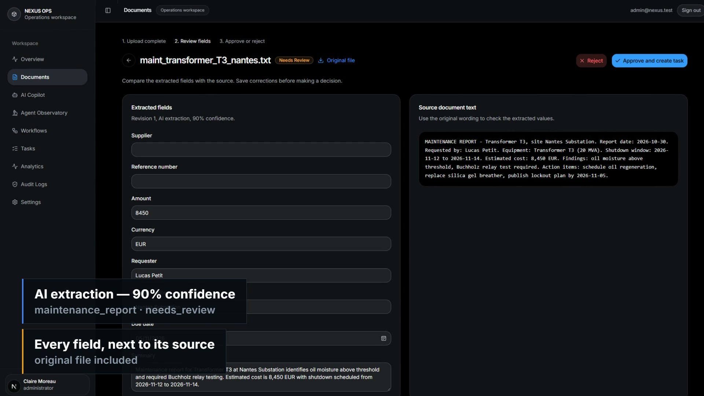
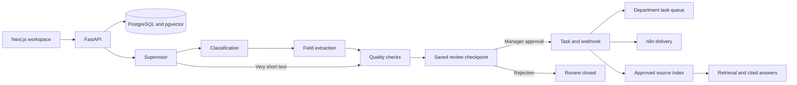

# Nexus Ops

Nexus Ops turns operational documents into work that a person can review and approve. Upload a supplier quote, purchase request, intervention report, maintenance report, or meeting record. The app extracts fields, flags issues, and waits for a manager before creating a task or dispatching automation.

The intended users are operations teams handling field and infrastructure paperwork. The useful boundary is the approval gate: model output becomes a proposal, and a person decides whether the workflow continues.

## Product tour

Recorded live from the running app — a document goes through the real pipeline, and the approve click dispatches it to n8n.

[](brag-output/brag.mp4)

## Follow one document through the app

1. **Upload** a PDF, DOCX, TXT, or CSV, up to 10 MB. The server retains the original file and extracts its text. Scanned PDFs need a text layer; OCR is not included.
2. **Inspect the extraction.** Classification identifies the document type and owning department. Extraction produces typed fields. Quality checks report missing values, invalid dates or currencies, and low confidence.
3. **Correct and save.** Compare the fields with the source text. Changes create a new revision; the AI extraction is retained. Save changes before approving.
4. **Make a decision.** A manager or administrator can approve or reject. Rejection ends the review. Approval resumes the workflow and creates a departmental task.
5. **Check delivery.** Open Workflows to see whether the n8n webhook succeeded, failed, or ran in mock mode. Authorized users can retry delivery. A failed webhook does not mean the task disappeared.
6. **Use the approved knowledge.** The copilot retrieves approved source documents within the user's permitted scope and provides citations. Check the cited source before acting on an answer.

The landing page also has a **local simulation** of this sequence. It uses predefined samples, runs without a backend, and sends no uploads or webhooks. Sign in to exercise the real API and database workflow.

## Run locally

You need Docker Compose, Python 3.14 or later with [uv](https://docs.astral.sh/uv/), and Node.js with npm. Node 22.13 or later is recommended for the frontend tooling. Run commands from this repository unless a step changes directory.

### 1. Configure the local environment

In PowerShell:

```powershell
if (!(Test-Path .env)) { Copy-Item .env.example .env }
docker compose up -d db
```

The database service uses PostgreSQL 17 with pgvector on port 5432.

For a repeatable demo without external model calls, use these values in the root `.env`:

```dotenv
NVIDIA_API_KEY=
GOOGLE_API_KEY=
EMBEDDING_PROVIDER=test
N8N_WEBHOOK_URL=
```

This selects keyword-based document extraction, deterministic hashing retrieval, and recorded mock webhook outcomes. Hashing retrieval is useful for an offline walkthrough; it is not semantic search.

For semantic retrieval, `EMBEDDING_PROVIDER=auto` uses Google embeddings when a Google key is configured, otherwise the local fastembed model. The local model needs an initial download. Keep the same embedding configuration for indexing and querying; rebuild the index after changing it.

### 2. Install and prepare the backend

```powershell
cd backend
uv sync
uv run alembic upgrade head
uv run python -m app.seed
uv run uvicorn app.main:app --port 8000 --reload
```

**Run the seed command only against a disposable demo database. It replaces existing application records.** It creates fictional users, documents, tasks, and demonstration traces. Seeded documents contain source text but do not have retained original files to download. Files you upload through the app do have retained originals.

The API starts at [localhost:8000](http://localhost:8000). Check [the health endpoint](http://localhost:8000/health) or inspect [the API reference](http://localhost:8000/docs).

### 3. Start the frontend in another terminal

```powershell
cd frontend
npm ci
npm run dev
```

Open [localhost:3000](http://localhost:3000) or [127.0.0.1:3000](http://127.0.0.1:3000). Run one frontend server at a time. Use `dev` while editing; `npm start` serves the last production build.

Local API requests use the browser's hostname on port 8000 so session cookies work with either local address. For another API origin, put `NEXT_PUBLIC_API_URL` in `frontend/.env.local` and restart Next.js. The root `.env` configures the backend; Next.js does not automatically load it from the parent directory.

### 4. Sign in and try the walkthrough

All seeded demo accounts use password `demo1234`.

| Account | Role | Try this |
| --- | --- | --- |
| `admin@nexus.test` | Administrator | Review documents, inspect traces, rebuild the copilot index |
| `manager@nexus.test` | Manager | Correct fields, approve or reject, inspect workflow delivery |
| `employee@nexus.test` | Employee | Upload and correct documents, use department-scoped copilot retrieval |

Start with [examples/supplier-quote.txt](examples/supplier-quote.txt). Upload it in Documents, change its summary, save the correction, and approve it as a manager or administrator. Follow the task and workflow links in the confirmation. Then ask the copilot about `DEMO-QUOTE-001` or `Example Grid Services`.

Try rejection with a second upload. It should produce no approval task or dispatch. Try an unsupported copilot question to see how the app explains insufficient evidence.

### 5. Connect n8n when you want real delivery

```powershell
docker compose up -d n8n
```

Open [localhost:5678](http://localhost:5678), import [n8n_workflow.json](n8n_workflow.json), and configure the webhook and signing secret. Set `N8N_WEBHOOK_URL` and `N8N_WEBHOOK_SECRET` in the root `.env`, then restart the backend. To push and activate the workflow with [n8n_setup.ps1](n8n_setup.ps1) instead of importing manually, set the `N8N_API_KEY` environment variable first; the script exits with an error if it is missing.

The backend signs the exact outgoing bytes with HMAC-SHA256 and sends the signature in `X-Nexus-Signature`. Webhook outcomes are recorded in Workflows. Empty webhook configuration records a mock outcome rather than reporting a real delivery.

## How the system is arranged



The graph in [backend/app/agents/graph.py](backend/app/agents/graph.py) is sequential: supervisor, classification, extraction, QA, then an interrupt before automation. Very short text takes the QA branch and still requires review. PostgreSQL stores checkpoints; tests use an in-memory checkpointer and SQLite.

The separate `process_document` helper runs classification and extraction in parallel for batch seeding. It is not the same execution path as an uploaded document. The copilot is a separate retrieval workflow, not a node running on every upload. Approval of older seeded records reconstructs a missing review checkpoint from saved database values and records that recovery in the audit trail.

### Responsibilities

| Part | Responsibility | Main source |
| --- | --- | --- |
| Frontend | Landing demonstration, upload, review, tasks, delivery, copilot, audit views | [frontend/app](frontend/app) |
| Document API | Upload validation, revisions, role checks, decisions, retained files | [documents.py](backend/app/routers/documents.py) |
| Pipeline | Validated classification and extraction, fallback behavior | [pipeline.py](backend/app/services/pipeline.py) |
| Agent graph | Checkpointed intake and approval resume | [graph.py](backend/app/agents/graph.py) |
| Task routing | Document-type rules and saved due dates | [routing.py](backend/app/services/routing.py) |
| Delivery | Signed webhooks and recorded outcomes | [n8n.py](backend/app/services/n8n.py) |
| Knowledge | Approved-source indexing, retrieval, answers, citations | [rag.py](backend/app/services/rag.py) |

### Providers and modes

Document-model selection is NVIDIA first, Google second, then the deterministic mock when neither key is configured. Models and URLs come from `.env`; the UI does not imply that both providers run on each request. Provider failures are marked as fallback in agent traces. Interactive NVIDIA copilot answers have a 30-second request budget. If answer generation fails, the copilot labels and returns matching retrieved source sentences with their original citation numbers. Retrieval or embedding failures produce a retryable error instead of silently switching embedding models.

Embedding selection is separate from language-model selection. Embedding vectors must use the same model when written and queried. The copilot searches original approved source text. Structured human corrections guide task creation; they do not rewrite the original source document.

All authenticated users can upload and edit documents awaiting review. Only managers and administrators can approve or reject and retry workflow delivery. Employees' copilot retrieval is limited to their department; managers and administrators can retrieve across departments. This is a demonstration role model, not a multi-tenant isolation system.

### Frontend behavior

The titanium core uses Three.js through React Three Fiber and Drei. Drag or use arrow keys to rotate it; Home resets the view. Zoom and pan are disabled. It renders on demand, with optional auto-rotation, and stops rendering when hidden or off-screen. Reduced-motion preferences disable automatic rotation. GSAP handles text entrances and capability reveals without scaling the 3D canvas.

The dashboard fetches its session and data on the client. Instant-navigation validation is explicitly opt-in because these screens cannot promise a fully rendered prefetched UI before authentication completes. Runtime prefetching remains enabled.

## Verify changes

Backend tests use deterministic providers and an isolated SQLite database. They do not reset your running PostgreSQL database.

```powershell
cd backend
uv run pytest -q
```

For the frontend:

```powershell
cd frontend
npm run lint -- --quiet
npm run build
```

With the development server running, the scripts in `frontend/scripts` exercise the UI with isolated browser fixtures or public seeded demo accounts. They require Chrome; set `CHROME_PATH` if it is not installed at the default Windows location.

```powershell
node scripts/ui-smoke.mjs
node scripts/login-smoke.mjs
node scripts/workflow-smoke.mjs
node scripts/scene-smoke.mjs
```

`ui-smoke` and `workflow-smoke` intercept API traffic with synthetic browser fixtures. `login-smoke` uses the real API and seeded login. `scene-smoke` checks rendering, interaction, and scroll behavior. Browser checks do not establish performance on every GPU or replace testing with your deployment configuration.

## Troubleshooting

| Symptom | Check |
| --- | --- |
| Login says it cannot reach the API | Check `/health`, port 8000, the API origin, and that the database is healthy. Both local frontend origins are allowed. |
| Styles or scripts return 500 | Stop duplicate frontend processes. Use one `npm run dev` server; avoid serving an old build while editing. |
| Upload takes time | Live model calls are synchronous. Keep the dialog open; it opens the review after completion. Use mock mode for a predictable offline demo. |
| Original download is unavailable | Seeded records have source text only. Upload a new file to demonstrate retained-file download. |
| Copilot has no relevant answer | Approve a source first, check your role scope, and ask about a specific fact in that source. Administrators can use Rebuild source index in Copilot after checking embedding configuration. |
| Workflow is marked mock | No live n8n webhook is configured. The task can still exist; mock means delivery was simulated. |

## Demo boundaries

The supplied records and business examples are fictional. Time-saved numbers are projections using `(manual minutes - assisted minutes) * annual volume / 60`; they are not measured customer results. Review completion is the share of documents approved or rejected, not an autonomous-processing rate.

The local app uses development credentials and cookies, an in-process rate limiter, synchronous model calls, and local file storage. It records audit events but does not enforce a write-once audit database. Webhook retries may deliver an event again, so downstream workflows must handle duplicates. Configure deployment-specific authentication, TLS, storage, recovery, and secrets before exposing it to real users.

## Positioning for the Santerne Bretagne PFE

This repository doubles as a concrete, working example of the project requested by the Santerne Bretagne final-year engineering internship (PFE) offer: an AI document-review pipeline with a human approval gate, backed by n8n automation and a RAG copilot with citations. The same codebase also serves as a methodological template (observe, map, prototype, measure, govern) for the internship deliverables. For the full mapping to the offer's six deliverables, projection arithmetic, and a demo runbook, see [docs/pfe-fit.md](docs/pfe-fit.md).

